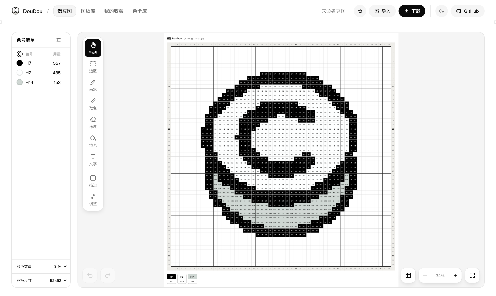

<div align="center">


# DouDou · 拼豆图纸

**任意图片 → 能直接拼的拼豆图纸。免费、开源，图片只在你的浏览器里处理。**

[在线使用](https://zlgan-spec.github.io/doudou-pindou/) · [做豆图](https://zlgan-spec.github.io/doudou-pindou/#/make) · [色卡库](https://zlgan-spec.github.io/doudou-pindou/#/colors)

[](https://zlgan-spec.github.io/doudou-pindou/) [](LICENSE)

**中文** · [English](README.en.md)



</div>

## 功能

- **传图就出图**：拖入、粘贴或选择图片，卡通、像素画、照片都行，支持 iPhone 照片（HEIC）
- **豆板尺寸**：自适应、52×52、78×78、104×104，或自定义宽高；超过 104 自动按 104 板分块，标出拼接线和板号
- **标准图纸**：每格标色号，每 10 颗一条粗线，四边坐标，底部色卡写清每个色号用多少颗
- **颜色数量可调**：滑块往左合并颜色，往右增加层次，松手就生效
- **在线编辑**：画笔、填充、选区、文字、多圈描边、降噪、镜像、移除背景、原图对照，随时撤销
- **下载即可再编辑**：下载的 PNG 里带着图纸数据，拖回来能接着改；大图下载成压缩包，一张总览加每块板一张
- **色卡库**：MARD 221 色，按色号或色值搜索，点一下复制

## 隐私

图片只在你的浏览器里处理，不会上传到任何服务器。没有账号，不用统计工具，不收集个人信息。收藏和设置只存在你自己的浏览器里。

## 怎么做到的

先判断输入是像素画、平涂图还是照片，再走对应的路径：像素画识别出原来的网格、一格一豆还原；平涂图保留原有配色；照片按色系分层取色。移除背景用一个约 4 MB 的模型在浏览器里运行。所有图案放进能装下它的最小豆板（52 / 78 / 104），超过 104 用几块板拼。详见 [工作原理](docs/how-it-works.md)。

## 本地运行

需要 Node.js 20 以上。

```bash
npm install
npm run dev     # 打开 http://localhost:5190
npm test
```

## Roadmap

- [x] 图片转图纸、在线编辑、下载后可再编辑
- [x] 自适应和自定义尺寸，大图按 104 板分块下载
- [x] 颜色数量双向调整
- [x] 图纸库：原创图纸陆续上架
- [x] 线条规整
- [ ] 满铺底色（杯垫用）
- [ ] 一键换配色（多组色号同时替换）
- [ ] 中轴对称修正

## 参与贡献

- 发现问题或有建议：[提一个 Issue](https://github.com/zlgan-spec/doudou-pindou/issues/new/choose)
- 想投稿图纸或参与开发：看 [CONTRIBUTING.md](CONTRIBUTING.md)
- 认为某张图纸侵犯了你的权益：用「图纸版权申诉」模板提 Issue，核实后会尽快移除

## 致谢与许可证

色号整理自公开的 MARD 色卡（MARD 是其权利人的商标，本项目与其没有官方关联）；抠图模型 U²-Netp（Apache-2.0）；像素字体 Fusion Pixel Font（OFL-1.1）。详见 [THIRD_PARTY_NOTICES.md](THIRD_PARTY_NOTICES.md)。

代码采用 [MIT](LICENSE) 许可证。
